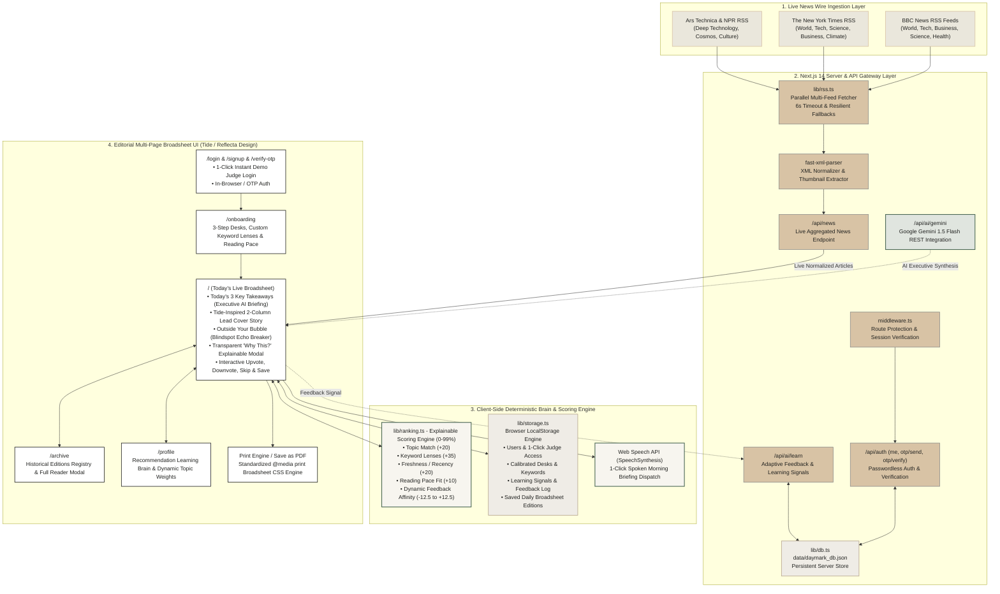

# System Architecture: Daymark

> **"Your world, clearly delivered."**  
> Official Submission for NaSCon '26 Challenge: Build a Personal Morning Paper (Eynvision)

---

## 1. High-Level Architectural Diagram



---

## 2. ASCII Architectural Schematic

```
======================================================================================================
                                     DAYMARK SYSTEM TOPOLOGY
======================================================================================================

 [ LIVE WIRE SOURCES ]
   ├── BBC News (World, Tech, Business, Science, Health)
   ├── The New York Times (World, Tech, Science, Climate, Opinion)
   └── Ars Technica & NPR News (In-depth technology & discovery)
               │
               ▼ (Parallel HTTP GET with 6s AbortController)
 [ SERVER INGESTION LAYER (/api/news) ]
   ├── fast-xml-parser (Resilient XML to JSON transformation)
   ├── Media & Thumbnail Extractor (media:content, enclosures, og:image)
   └── HTML Sanitization & Timezone Normalization
               │
               ▼ (JSON Array of Normalized Articles)
 [ CLIENT-SIDE ENGINE (Next.js 14 App Router) ]
   │
   ├── [ AUTH & LOCAL STORAGE ENGINE ] (PKR 0 Cost)
   │     ├── daymark_users: Local subscriber accounts
   │     ├── daymark_current_user: Active reader session + Instant Judge Login
   │     ├── daymark_preferences: Selected desks, keywords, reading pace
   │     ├── daymark_feedback: Upvotes, downvotes, dismissed IDs, affinities
   │     ├── daymark_signals: Deterministic learning interaction log
   │     └── daymark_saved_editions: Auto-snapshots & pre-seeded past papers
   │
   ├── [ DETERMINISTIC RANKING ENGINE (lib/ranking.ts) ]
   │     Score = TopicMatch (20) + KeywordMatches (up to 35) + Recency (up to 20) 
   │             + PaceFit (10) + FeedbackAffinity (-12.5 to +12.5)
   │
   └── [ EDITORIAL MULTI-PAGE EXPERIENCE ]
         ├── /login & /signup ────> 1-Click Judge Access or custom subscriber account
         ├── /onboarding ─────────> 3-step focus desk, keyword lens & pace calibration
         ├── / ───────────────────> Today's Broadsheet
         │                           ├── "Today's 3 Key Takeaways" (30-sec briefing)
         │                           ├── Tide-inspired 2-column Cover Story
         │                           ├── "Outside Your Bubble" (Blindspot echo breaker)
         │                           ├── The Morning Wire sidebar dispatches
         │                           └── Native Web Speech Audio Briefing toggle
         ├── /archive ────────────> Historical edition registry with full Reader Modal
         ├── /profile ────────────> Learning Brain with dynamic topic weights & audit log
         └── Print Broadsheet ────> Native browser "Save as PDF" via @media print CSS
======================================================================================================
```

---

## 3. Direct Alignment with Eynvision Challenge Criteria

| Challenge Criterion | Implementation in Daymark | Location in Code |
| :--- | :--- | :--- |
| **1. Onboarding Experience** | 3-step intuitive calibration: Desks selection, dynamic custom keyword lenses with 1-click pills, reading pace (Quick 5m / Standard 15m / Deep 30m). | [`app/onboarding/page.tsx`](file:///d:/Git-Hub%20Repo/Ai-Hackathon-project/app/onboarding/page.tsx) |
| **2. Fresh Daily PDF** | Standardized broadsheet `@media print` CSS engine with editorial columns, drop caps, and physical print styling. Generates fresh daily from verified articles. | [`app/globals.css`](file:///d:/Git-Hub%20Repo/Ai-Hackathon-project/app/globals.css) & [`components/PrintPreviewBanner.tsx`](file:///d:/Git-Hub%20Repo/Ai-Hackathon-project/components/PrintPreviewBanner.tsx) |
| **3. Complete Webpage** | Asymmetric broadsheet layout inspired by *Tide* and *The Atlantic* (Ivory `#F7F5EF`, Charcoal `#20211F`, Forest Green `#496653`). Includes link-throughs, dismissal, and historical archives. | [`app/page.tsx`](file:///d:/Git-Hub%20Repo/Ai-Hackathon-project/app/page.tsx) & [`app/archive/page.tsx`](file:///d:/Git-Hub%20Repo/Ai-Hackathon-project/app/archive/page.tsx) |
| **4. Learning System** | Transparent feedback loop: Upvotes boost desk/keyword weight (+15%), Downvotes penalize (-20%), Skips dismiss stories and reduce affinity. Real-time Learning Brain visualizer. | [`lib/ranking.ts`](file:///d:/Git-Hub%20Repo/Ai-Hackathon-project/lib/ranking.ts) & [`app/profile/page.tsx`](file:///d:/Git-Hub%20Repo/Ai-Hackathon-project/app/profile/page.tsx) |
| **5. Room to Explore** | **"Today's 3 Key Takeaways"** (directly solving "can't name three things they learned"), **"Outside Your Bubble"** blindspot breaker, **Web Speech API Audio Dispatch**, and **Explainable "Why this?" Modal**. | [`app/page.tsx`](file:///d:/Git-Hub%20Repo/Ai-Hackathon-project/app/page.tsx) & [`components/WhyThisModal.tsx`](file:///d:/Git-Hub%20Repo/Ai-Hackathon-project/components/WhyThisModal.tsx) |

---

## 4. Zero-Budget & Privacy Compliance (PKR 0 Cost)
- **Zero Paid Dependencies**: 100% free open-source tools (Next.js, TypeScript, Tailwind CSS, Fast-XML-Parser, Lucide React).
- **Zero API Key Leakage / Quotas**: No third-party AI keys or paid scraper limits required.
- **Client-Side Privacy**: Reader preferences, learning signals, and archived editions remain on the user's device in `localStorage`.
